# CFS Order Panel: Staff Guide

This guide shows you, step by step, how to use the new order screens in Shopify. They do the same job as the Orders section of the old CFS admin.

**Guide version:** 53 (27 November 2026)

## Before you start

- **Words in bold** are buttons or labels you will see on the screen.
- The pictures come from a test order. The names and numbers in them are not real customers.
- Each feature has a tag:
  - **Ready:** we have tried it in the live system and it works.
  - **Ready, not yet tried:** it is finished, but we have not tried it live yet.
  - **Waiting:** it is switched off until the office tells us how it should work.

## What you can do today

| # | What it does | Tag |
|---|---|---|
| 1 | See all orders in one list | Ready |
| 2 | See orders one product at a time, by brand | Ready |
| 3 | Open one order and change its status, dates and notes | Ready |
| 4 | Print invoices, delivery notes and labels | Ready |
| 5 | Add or swap a product on an order | Ready |
| 6 | Add delivery charges such as Two Man Delivery | Ready |
| 7 | Mark a delivery as confirmed, add tracking and instructions | Ready |
| 8 | Ask for a refund and keep the list of refunds | Ready |
| 9 | Download spreadsheets | Ready |
| 10 | Edit the emails customers get | Ready |
| 11 | Send one email to many customers | Ready |
| 12 | Change a made-to-order product | Ready |
| 13 | Download the Xero invoice report and the Delivery report | Ready |
| 14 | Say which brands are paid on credit or pro-forma, one by one or from Excel | Ready |
| 15 | Find every page from the Dashboard | Ready |
| 16 | Download the Outstanding Payments report (what we owe suppliers) | Ready |
| 17 | Download the Outstanding In-Stock Items and Unpaid Invoices reports | Ready |
| 18 | Keep a list of free stock (goods we already own), fill it from Excel, correct or delete items | Ready |
| 19 | Give free stock to an order's item instead of buying it again, and take it back | Ready |
| 20 | Keep a list of stock arriving in containers, with expected dates and freight, and give it to an order's item | Ready |
| 21 | Keep a list of goods to send back to the supplier, and display pieces, and mark them collected | Ready |
| 22 | Choose which staff can change delivery charges, work the refund list and print delivery notes | Ready |
| 23 | Email the supplier an order form (Process Order) and set lines to Order in Progress, from the order, the Orders list and Orders by Brand | Ready, not yet tried |
| 24 | Supplier Chaseup and Date Lapsed lists, with a chase-up email to the supplier | Ready, not yet tried |
| 25 | Keep each brand's supplier email, and mark brands you order from by hand | Ready, not yet tried |
| 35 | Area page (named groups of postcodes) | Ready, not yet tried |
| 36 | Instock Balance Due (orders that still owe money while every item is in stock or on its way) | Ready, not yet tried |
| 37 | Pay To Supplier and Supplier Paid (check costs, add invoice numbers, mark lines paid or unpaid) | Ready, not yet tried |
| 38 | Supplier Payments (your own list of items to pay, filled with Add To Accounts on an order) | Ready |
| 39 | Proforma Payment Report and Credit Payment Report (items to pay suppliers for, with the invoice amount with and without VAT) | Ready |
| 40 | Reschedule Delivery Orders, and the Delivery attempted before? question when rescheduling on an order | Ready |
| 41 | Minerva Supplier Orders (discount due from Minerva brands on what we paid them) | Ready |
| 42 | Power BI Analytics (the four Power BI reports inside the app) | Ready, not yet tried |
| 43 | Create Payment Batch & Draft Email on Pay To Supplier (payment advice email to the supplier) | Ready |
| 44 | Order Reports (orders between two dates by status: sales, charts, page totals, line-by-line CSV) | Ready |
| 45 | Supplier Sales Summary (sales per website and brand, with Order Breakup) | Ready |
| 46 | Marketing Sales Report (item sales by brand, range, category, product, month, day, source or order; CSV) | Ready |
| 34 | Supplier Collection page (book by brand, van and date; address on Suppliers page) | Ready, not yet tried |
| 33 | Instock Delivery Not Booked page (payment filter, CSV of ticked items) | Ready, not yet tried |
| 32 | Carrier pages (TNT, Pallet, FurDeco, DHD, White Glove, Allocated + Booked) with filters, email and CSV | Ready, not yet tried |
| 31 | Completed Delivery, Failed Delivery/Collection and On Hold Delivery pages with filters and CSV downloads | Ready, not yet tried |
| 30 | Delivery Report CSV (Max) page (Maxpro): paid orders still to deliver, brand filter, White Glove list, Send Bulk Email, Order Wise and Product Wise files | Ready, not yet tried |
| 29 | Delivery Booked page: every booked delivery by day, van and driver in drop order; change drops, reschedule, download the day, a Pick List or a Driver Sheet | Ready |
| 28 | Book Delivery page: tick the ready lines, mark TNT/Pallet/FurDeco or book them onto a van with drops and times, email the customers | Ready |
| 26 | Van Management and Driver Management: tables like the old system, with ADD NEW, INACTIVE, ACTIVE and DELETE; a van has a driver and co-driver | Ready, not yet tried |
| 27 | Book Delivery box on an order, laid out like the old system: partner, date, driver, van, drop, slot, Book & Email, Book & Save, Reschedule | Ready |
| 47 | Customer delivery confirmation: CLICK HERE TO CONFIRM in the booking email opens a page on the store website; the answer shows on the delivery pages. Bulk Reschedule and Not Confirmed Email on the delivery pages | Ready |

---

## 1. Opening the app

1. Sign in to Shopify.
2. On the left, click **Apps**, then **cfs-order-status-panel**.
3. The list of orders opens.

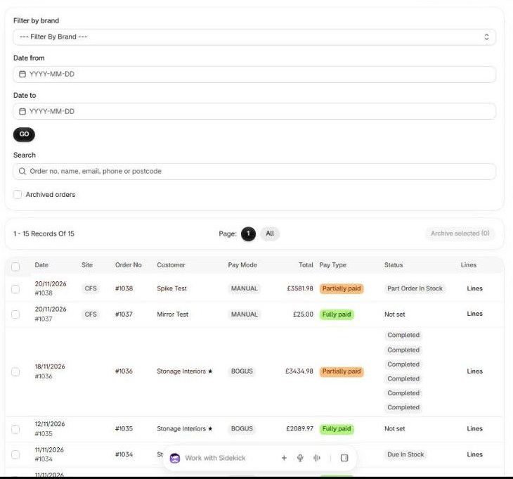

**Buttons at the top right:**

- **Orders by Brand:** the product-by-product list.
- **Refund Orders List:** the list of refunds for accounts.
- **Email templates:** the wording of customer emails.
- **Refresh order data:** updates the lists (see below).

**Good to know**

- If the page shows "Loading" for a long time, wait one minute and reload. The system goes to sleep when nobody uses it and needs a moment to wake up.
- If you see a message saying you are not verified, reload the page.

**When to press Refresh order data:** only if the lists look out of date. It updates a few orders at a time and tells you how many it did. It is safe to press as often as you like.

---

## 2. The Orders list

**What it is for:** finding an order and seeing how it is going.

**How to use it**

1. **Search:** type any of the order number, name, email, phone or postcode. You can type more than one word.
2. **Filter:** pick a brand, or pick a start and end date and press **GO**.
3. **Look inside an order:** press **Lines** at the end of the row. The products in that order open above the list. Press **Open order** to go to the full order, or **Close** to shut it.
4. **Hide an old order:** tick it and press **Archive selected**. Tick **Archived orders** to see hidden ones, then press **Restore** to bring one back. Nothing is deleted.

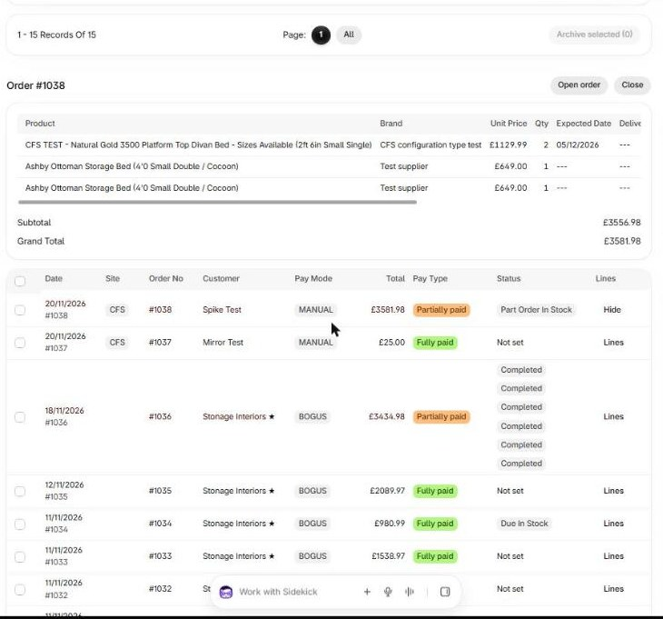

**What the colours and marks mean**

- A **red row** means the customer has only part paid.
- A **blue row** means a replacement order.
- A **star** next to a name means the customer has ordered before.
- **Pay Type** tells you if the order is Fully paid, Partially paid, Awaiting payment or Payment failed. A cancelled order shows Payment failed.

---

## 3. Orders by Brand

**What it is for:** chasing suppliers. One row for each product, not each order.

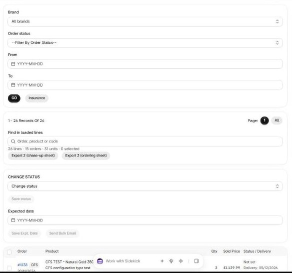

**How to use it**

1. Choose a **Brand**, and an **Order status** if you want one. Finished statuses are hidden until you choose them.
2. Press **GO**. The line under the filters shows how many lines, orders and units you have.
3. Use **Find in loaded lines** to search inside the list.
4. **Change many products at once:** tick the rows, choose a status under **CHANGE STATUS** and press **Save status**. Or pick a date under **Expected date** and press **Save Expt. Date**.
5. **Send one email to many customers:** tick the rows and press **Send Bulk Email**. Each customer gets one email, even if you ticked several of their products. You can change the subject and message before you send.

**Good to know:** a yellow tag "Out of stock, due on a date" means the product is not in stock yet but a date is known. A red tag means there is no date.

---

## 4. One order: status, dates and notes

Click an order number to open the full order.

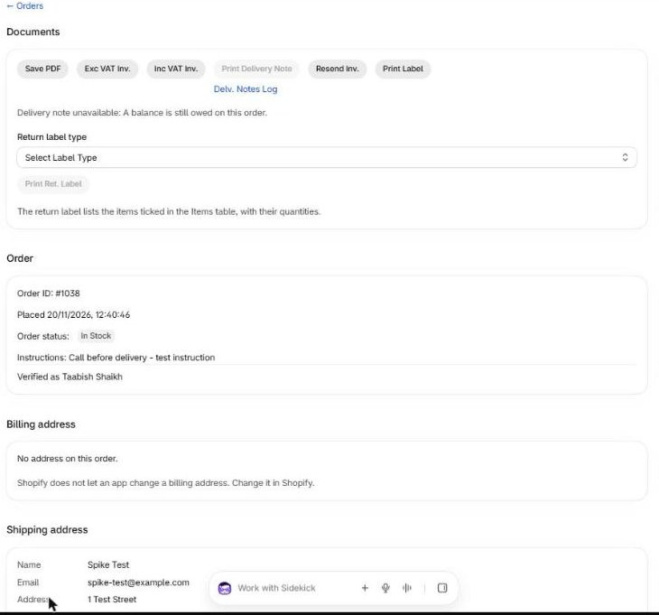

**Change the status**

1. Go to the **Status** box. Under **Apply to**, choose **Whole order** or **Selected items** (tick the products first in the Items table).
2. Pick a status and press **Save status**.
3. Tick **Email the customer** only if they should be told.

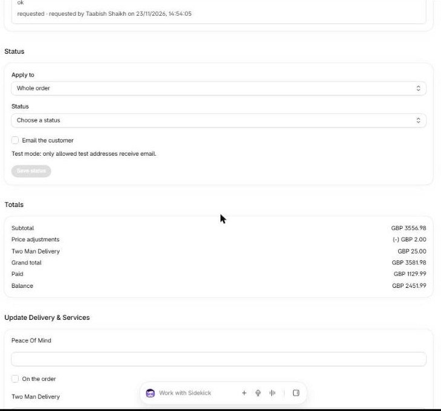

**Set the expected date**

1. Use the calendar to pick the date. Do not type it, because typing can lose the last digit.
2. If needed, choose a condition: Normal Order, WAIT FOR ENTIRE ORDER, OK FOR PART DELIVERY, 50% Refund or 75% Refund.
3. Save.

**Notes and instructions:** type them in the notes boxes and save. They show on the order and on the delivery note.

**History:** every change is recorded with who made it and when. Press **Show older history** to see more.

---

## 5. Printing documents

At the top of the order you will find these buttons (see the picture in section 4):

- **Save PDF:** a copy of the whole order.
- **Exc VAT Inv.** and **Inc VAT Inv.:** the invoice without or with VAT.
- **Print Delivery Note:** works only when nothing is owed and the order is not on a 50% or 75% refund. The screen tells you why if it is greyed out. Every print is recorded.
- **Delvn Notes Log:** shows who printed delivery notes and when.
- **Print Label:** the delivery label.
- **Print Ret. Label:** first choose the label type (Free Stock, Display Stock or Send Back To Supplier), tick the products in the Items table, then print.
- **Resend Inv.:** emails the invoice to the customer. **Waiting:** it stays switched off until the office decides the wording.

**Not ready yet:** the invoice "Code" column and the warehouse and box details are blank. We are waiting to hear where that information should come from.

---

## 6. Adding or swapping a product

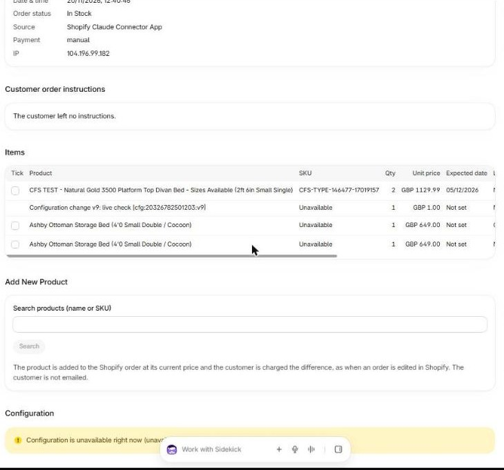

**Add a product**

1. Find **Add New Product**. Type a name or code and press **Search**.
2. Choose the product and options, then add it.
3. It is added to the Shopify order at today's price. The customer is charged the difference, just like when you edit an order in Shopify. The customer is not emailed.

**Swap a product:** search for the new product and choose to swap it for the line you want to replace. The old line stays on the order with quantity 0, and the new one is added.

---

## 7. Delivery charges

Find **Update Delivery & Services**.

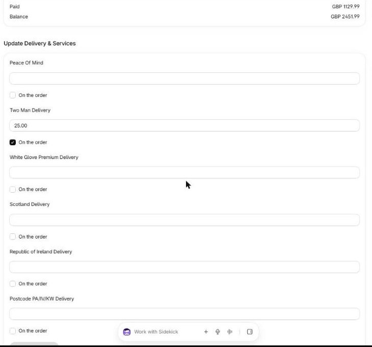

1. Type the amount for the charge (Peace Of Mind, Two Man Delivery, White Glove Premium Delivery, Scotland Delivery, Republic of Ireland Delivery or Postcode PA/IV/KW Delivery). VAT is included in the amount.
2. Tick **On the order**.
3. Save. The charge is added to the Shopify order, so the total and balance change.
4. To remove a charge, untick it and save.

---

## 8. Delivery answers, tracking and extras

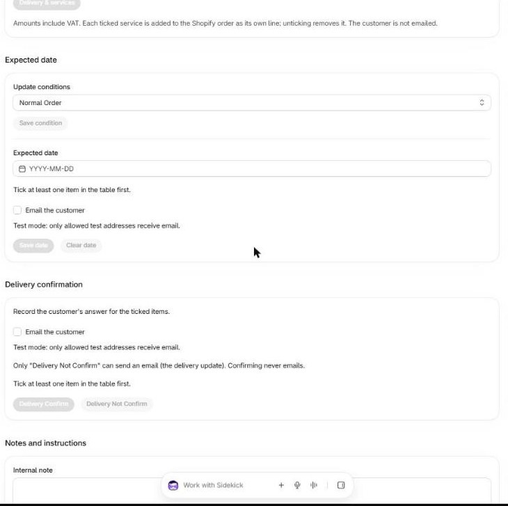

Tick the products in the Items table first. The buttons stay grey until you do.

- **Delivery Confirm** and **Delivery Not Confirm:** record what the customer said. Tick **Email the customer** if they should be told.
- **Edit** under the shipping address: change the contact details. Billing addresses can only be changed in Shopify itself.
- **Order and delivery instructions:** write them once and they show at the top of the order.
- **Show more tools:** opens the less-used boxes:
  - **Supplier Invoice Update:** for each product, the supplier invoice date, number and amount, and whether it is paid.
  - **Tracking:** type the tracking number. Tick **Email the customer** to send the tracking email.
  - **Email log:** every email for this order, and whether it was sent. Press **Retry** on any that failed.

---

## 9. Refunds

### Asking for a refund

1. Open the order and find **Payment & Refund**.
2. Tick **REFUND**.
3. Choose **Full Refund** (the amount fills in by itself) or **Part Refund** (type the amount).
4. Write a short note. A note is required.
5. Save.

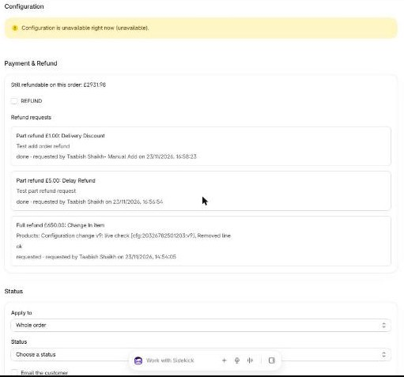

**Important:** this only puts the order on the refund list for accounts. **No money moves.** **Still refundable** shows how much can still be refunded.

### The Refund Orders List
Open it with **Refund Orders List** at the top of the app.

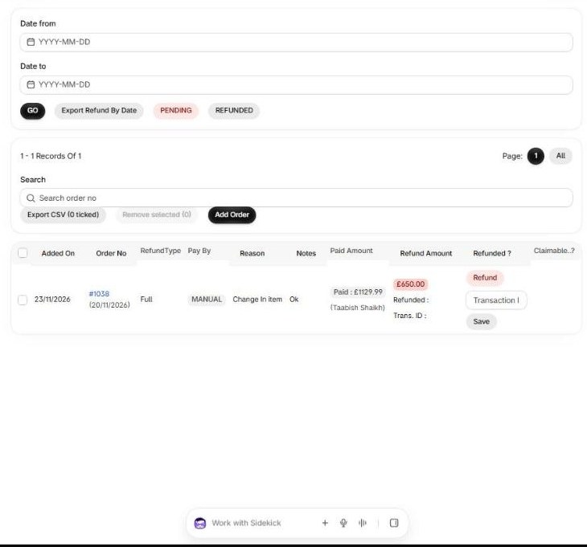

1. Use **PENDING** and **REFUNDED** to choose what you see.
2. When accounts have paid the customer, type the transaction number in the box, press **Save**, then press **Refunded**. The date is filled in for you.
3. **Add Order** adds a refund by hand. You must write a note, and it is marked "Manual Add".
4. **Remove selected:** tick a record and press **Remove selected** to take it off the list (for example a refund added by mistake). The system asks you to confirm. The record is not lost: it is kept, marked as removed with your name, and shows as cancelled on the order.
5. **Export CSV** downloads the list. **Export Refund By Date** downloads refunds for the dates you chose.

**Waiting:** how the refund is really paid (on the card company's site or from Shopify) is not decided yet. For now the list is a record only. The **Claimable** column is empty until the office tells us what it should show.

---

## 10. Customer emails

**What it is for:** changing what customers read in the emails.

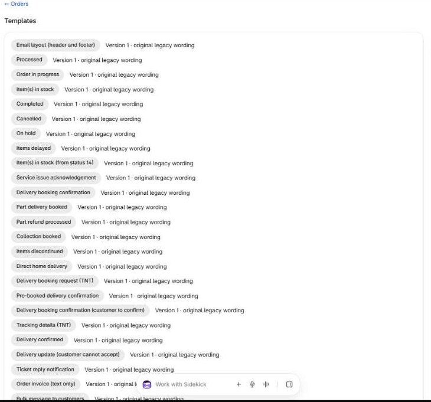

1. Press **Email templates** at the top.
2. Click the email you want. You can edit the words, preview it, and press **Send test**.
3. Every change is saved as a new version, and you can go back to an older one.
4. Each shop (CFS, TFS, FURN/eBay, UD, MM) has its own wording and sender.

**Good to know:** while we are testing, emails only go to approved test addresses. Real customers are not emailed until the system is switched to live.

---

## 11. Downloading spreadsheets

A link appears on screen and works for 5 minutes. Click it to download.

| Button | Where | What you get |
|---|---|---|
| **Export CSV** | Refund Orders List | The refund list |
| **Export 2 (chase-up sheet)** | Orders by Brand | One row per product, for chasing suppliers |
| **Export 3 (ordering sheet)** | Orders by Brand | The sheet used to place supplier orders |

A "---" in the Expected Date column means no date has been set.

---

## 12. Changing a made-to-order product

Some products are made to order. For these, the **Configuration** box on the order shows the options the customer chose.

1. Choose the new options.
2. Press **Check price** to see how much more or less it will cost.
3. Type the reason and press **Apply change**. Any price difference is added to the order.

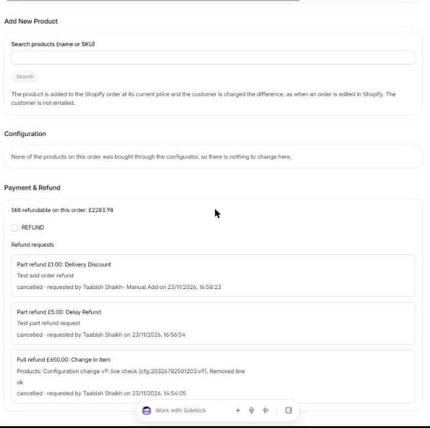

If none of the products on the order were made to order, the box says there is nothing to change.

**If it says "unavailable":** the configuration system is asleep. Wait a minute and reload the page.

---

## 13. Reports

Each report has its own card in the **Downloads** group on the **Dashboard**, as in the old Downloads menu: **Order Reports** (below), **Marketing Sales Report** (below), **Xero VAT Invoice Report**, **Outstanding Payments Summary**, **Outstanding In-Stock Items**, **Supplier Sales Summary** (below), **Unpaid Invoices Report** and **Delivery Report**. A card opens just that report; **All reports** shows them all on one page (as does **Reports** at the top of the order pages). Each report has a download button. A link appears on screen and works for 5 minutes. The **Sales Summary** card opens the sales summary on the website in a new tab, like the old menu.

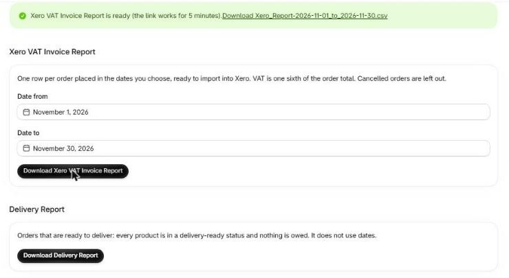

### Order Reports

Open **Order Reports** from the **Downloads** group on the **Dashboard**. It opens on today's orders.

1. Choose **From** and **To**, or press a shortcut: **Today**, **Yesterday**, **Current Week**, **Previous Week**, **Current Month**, **Previous Month**, **Current Year** or **Previous Year**. Weeks start on Monday.
2. To see only some order statuses, press **Order status**, tick them (type in the search box to find one; **Select all** and **Clear** help). With none ticked, every order except Deleted ones is shown.
3. Press **Apply filters**. Until you do, the page says "Filters changed".

At the top you see:

- **Matching orders**: how many orders match the dates and statuses.
- **Date-range sales**: the total of the orders placed in the dates, leaving out Cancelled, Deleted, Order Failed, Awaiting Payment and Awaiting V12 Approval orders. The status filter does not change it.
- **Avg. valid order**: the average of those orders with a total above £0.

**Charts** (dates only, the status filter does not change them): choose **Brands** (sales per brand, top 17), **Payments** (sales per payment method) or **Order line statuses** (how many products are in each status).

**Orders** lists 50 orders a page: Order No. (red if money is still owed; click to open the order), Customer, Date, Mode (payment method), Subtotal, Discount, Coupon, White Glove, Two Man, Scotland (Scotland, Republic of Ireland and PA/IV/KW postcode charges), Order Total and Status. Click a column name with an arrow to sort by it; click again to reverse. The last row is the **Page total**.

**Export data** downloads every order on the filters (all pages) as a spreadsheet with one row per product and the old file's 64 columns. Choose a brand in **Export brand** first to get only that brand's products. Charges for the whole order (delivery, Two Man, White Glove and so on) go on the order's first product row. That row's **Grand Total** also carries everything else on the order that is not a product (delivery, services, configuration price changes, whole-order discounts), so each order's rows add up to its Shopify total. With one brand chosen, its first row carries them. **Cost Price** is the Shopify cost; **Total Cost** is the manual cost from Pay To Supplier if one was typed. A discount on the whole order (such as a coupon) is shown in **Voucher Discount** on the first row. Columns we do not hold yet are empty: Regular, Prepayment and Collection Discount, Supplier OfferCost, New Cost, Offer and Voucher Discount %, Northern Ireland Delivery, Transaction Id, Card Net, Delivery Cost and Brand Group.

**Good to know:** coupon codes and the White Glove, Two Man and Scotland charges are saved with an order from now on. Older orders show them after they next change, or after **Refresh order data** is pressed on the Orders page. The old page's extra chart views (cities, postcodes, hours, coupons and so on) are not copied.

### Supplier Sales Summary

Open **Supplier Sales Summary** from the **Downloads** group on the **Dashboard**. It shows how much each brand sold, one table per website. It opens on today.

1. Choose **From** and **To**, or press **Today**, **Yesterday**, **This Month**, **Last Month**, **This Year** or **Last Year**, then press **Go**.
2. Each table has one row per brand: **Sale Total** (what the customers paid for that brand's products, without delivery), **Grand Total** (with the brand's share of the delivery charges) and **Units**. The last row is the website's **Total**. Click a column name to sort by it; click again to reverse.
3. Press **Order Breakup** to add an **Orders** column, then click a brand to see its orders under it: order number (click to open), date, status, the delivery shares (2Man, WG, Scot, Far, IRE, POM), Sale, Grand Total, Qty and a check. **✓ OK** means the brand's Grand Total matches the order total; a red **±£** shows the difference (often the 1 Man postage, which is not a delivery share, as on the old page). Orders with several brands say **split order** and are not checked. **Hide Breakup** goes back.

How the figures are made, as on the old page:

- Cancelled, Deleted, Order Failed, Awaiting Payment, Awaiting V12 Approval and Service Issue orders, and replacement orders (number starting with R), are left out.
- Orders paid in the store (card or cash) or taken on Shopify POS are one **Store Orders** row, marked **store**.
- Each delivery service charge (Two Man, White Glove, Scotland, PA/IV/KW postcodes, Republic of Ireland, Peace of Mind) is shared equally between the order's products, so a brand with 2 of the order's 3 products gets two thirds.
- A coupon on the whole order and configuration price changes are shared between the order's brands by their sales, so Sale Total is what was really charged.
- An order's website comes from its `site:` tag (eBay orders are found by themselves). Orders without one are under **No site** until the real site rule is set.

### Marketing Sales Report

Open **Marketing Sales Report** from the **Downloads** group on the **Dashboard**. Only staff with the **See the Marketing Sales Report** tick can open it (see Permissions), as the old menu showed it to two staff groups only. It opens on this month up to today, by brand, highest sales first.

1. Press a **Quick dates** button (Today, Yesterday, Current week, Previous week, Current month, Previous month, Current year, Previous year) or type **From date** and **To date**.
2. Choose any of **Brand**, **Range (collection)**, **Category**, **Product name or SKU**, **Break down by** (Brand, Range, Category, Product, Month, Day, Order source or Orders) and **Sort by**. **More filters** has **Product ID**, **Site**, **Order source** and **Eligible order status**.
3. Press **Apply filters**. Until you do, the page says *Filters changed*; **Discard changes** puts the form back. **Start over** clears everything.
4. The four boxes show **Matching orders** (click to list them), **Units sold**, **Item sales** and **Products sold**.
5. The table has one row per group with **Orders**, **Units** and **Item sales**. Click an order count or **View orders** to see the orders behind a row. **View ranges**, **View products** and **View monthly sales** go one step deeper (brand → ranges → products → months). On the Orders view, **View matching items** shows that order's items and **Open order** opens it.
6. The filters in use show as chips under the heading; click the **×** on a chip to remove it, or **Clear all filters**. The path at the top (**All sales › brand › range**) takes you back up.
7. **Export CSV** gives a link to the whole breakdown (all pages, up to 10,000 rows) with the old file's heading lines.

How the figures are made, as on the old page:

- **Item sales** is each item's price × quantity less its own discount. Delivery, service charges and a coupon on the whole order are not included, and refunds are not subtracted.
- Orders with a total of £0, replacement orders (number starting with R) and items with no quantity are left out. Orders and items in Cancelled, Deleted, Order Failed, Awaiting Payment, Payment Not Confirmed, Awaiting V12 Approval, Cancel-Removed or Payment Not Come are left out.
- **Range** is the product's Shopify collection, and a product in two collections counts in both. **Category** is its Shopify category (or product type). Both are read from Shopify as they are now.
- **Site** and **Order source** come from the order's tags; most orders have none yet, so the report starts on **All sites** (the old one started on CFS).

### Xero VAT Invoice Report

1. Choose **Date from** and **Date to** (up to one year).
2. Press **Download Xero VAT Invoice Report**.
3. Click the link that appears.

You get one row per order placed on those dates, ready to import into Xero. VAT is worked out as one sixth of the order total. Cancelled orders are left out.

### Outstanding Payments

This shows the products we have not yet paid the supplier for.

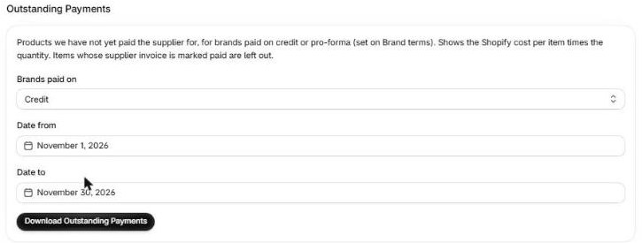

1. First set each brand to **Credit** or **Pro-forma** on **Brand terms** (see section 14).
2. On the Reports page, choose **Brands paid on**: Credit or Pro-forma.
3. Choose **Date from** and **Date to**. These are the dates the orders were placed.
4. Press **Download Outstanding Payments** and click the link.

Each row shows the order, brand, product, quantity, **Total Cost** (the Shopify cost per item times the quantity), status and expected date. Products whose supplier invoice is marked **paid**, products of cancelled orders and removed products are left out.

**Good to know:**
- If a product has no cost in Shopify, its Total Cost is blank. Add the cost in Shopify under the product's variant.
- If no brand is set to that choice, the file has headings only.
- Delivery Date is blank for now. The new system does not keep one yet.
- Credit brands count more statuses than pro-forma brands, as in the old system.

### Outstanding In-Stock Items and Unpaid Invoices

These two work like Outstanding Payments, but they cover **every brand** (there is no Credit or Pro-forma choice).

1. On the Reports page, choose **Date from** and **Date to** in the box you want. These are the dates the orders were placed.
2. Press the **Download** button and click the link.

Each row shows the order, brand, product, quantity, **Total Cost** and status. A product only appears if:
- it has **come into stock** at some point,
- its supplier invoice is **not marked paid**,
- its name does not contain "Clearance", and
- it is in the right status for that report.

**Outstanding In-Stock Items** is for accounts to see what to pay now. It lists every status except Payment Process, Cancelled and a few others.
**Unpaid Invoices Report** only lists products in one of these statuses: Order in Progress, In Stock with Supplier, Delayed, Invoice Received, Payment Process, Coming IN, In Stock and Completed.

**Good to know:**
- A product only counts as "came into stock" once it has been set to **In Stock** in this system. Orders saved before then need **Refresh order data** on the Orders page once, so the dates are filled in.
- A product set straight to **DHD with Supplier** also counts.
- A blank Total Cost means the product has no cost in Shopify.

### Delivery Report

1. Press **Download Delivery Report**. No dates are needed.
2. Click the link that appears.

You get the orders that are ready to deliver: every product is in a delivery-ready status and nothing is owed. It shows the customer, address and phone number for the delivery company.

**Good to know:** the depot name ("Choice Furniture") and the drop times (7:30 to 16:00) are copied from the old system. Tell us if they have changed.

---

## 14. Brand terms

Some suppliers are paid on **credit** (we pay later) and some are paid **pro-forma** (we pay first). The payment reports need to know which is which.

### Setting a few brands

1. Press **Reports**, then **Brand terms**.
2. Use the **Search brands** box to find a brand, or use the page numbers.
3. Next to the brand, choose **Credit**, **Pro-forma** or **Not set**. It is saved straight away, and a green message confirms it.

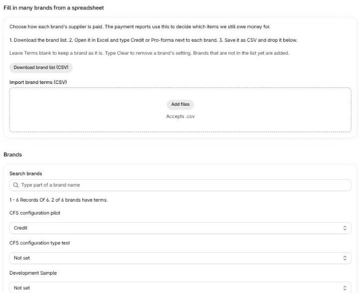

### Setting many brands from Excel

1. Press **Download brand list (CSV)** and click the link. You get a file with two columns, **Brand** and **Terms**. It lists every brand, with the terms already set.
2. Open it in Excel. In the **Terms** column type **Credit** or **Pro-forma** next to each brand.
3. Save the file as **CSV**.
4. Drop the file on the **Import brand terms** box (or click the box and pick the file).
5. A message tells you how many were saved. If some rows could not be used, the page lists them with their row number so you can fix them.

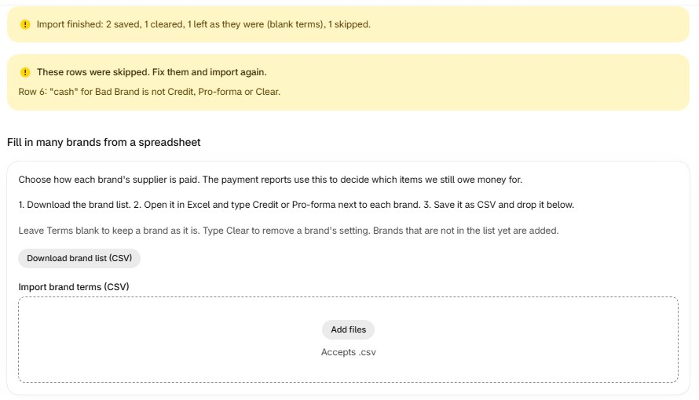

**Rules for the Terms column:**
- **Credit** or **Pro-forma** (capitals and the dash do not matter).
- Leave it **blank** to keep the brand as it is.
- Type **Clear** to remove a brand's setting.
- A brand that is not on the list yet is added.
- Keep the headings **Brand** and **Terms** in the first row. Up to 5,000 brands at a time.

**Good to know:** only signed-in staff can change this. The downloaded list is also the best sample to start from.

---

## 15. The Dashboard

The Dashboard is a page with one big card for every part of the app, grouped like the menus of the old admin: **Orders**, **Stock**, **Delivery**, **Accounts**, **Downloads** and **Settings**. Each card says in a sentence what the page is for.

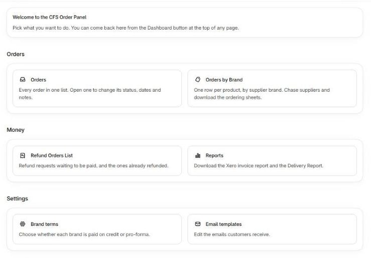

1. Press **Dashboard** at the top of any page.
2. Click the card you want.

If you ever feel lost, press **Dashboard** and start again.

At the top of the Dashboard is a row of tiles with live numbers. **Red** means something is overdue (Date Lapsed), **amber** means work is waiting (chase-ups due, refunds to pay, SBTS items to collect), **green** means all clear, and blue or grey tiles are for information. Press a tile to open that list.

The Orders by Brand, Supplier Chaseup and Date Lapsed lists also start with small count tiles (lines, orders, ticked). On the chase-up lists an expected date is **red** once it has passed and **amber** when it is due within three days. When a list has nothing to show, you now get a short message that says what to try next.

---

## 16. Stock

**Free stock** is goods we already own, for example from a cancelled or returned order. Keeping a list of it means we can give it to another order instead of buying it again. You keep the list on this page, then give stock to an order from the order's own page (see **Giving free stock to an order** below).

Open it from the **Dashboard**: click the **Stock** card.

### Adding one item
1. In **Add free stock**, type the **Brand**, **Product code** and **Quantity**. The product name, cost, source order and remarks are optional.
2. Press **Add to stock**.

### Adding many items from Excel
1. Press **Download sample (CSV)** and click the link.
2. Open it in Excel and replace the example row with your stock. Brand, Qty and Product Code are needed on every row.
3. Save it as CSV and drop it into the box.

You will see how many rows were added and why any were skipped. **Importing always adds new rows**, so do not import a list you downloaded from the page. If you leave Warehouse Code blank, the item is given a code such as FSS12.

### Correcting or deleting an item
- Press **Edit** on an item, change what is wrong and press **Save changes**. Set the quantity to **0** to mark an item as used up.
- Press **Delete**, then **Yes, delete**, to remove an item for good. This cannot be undone. If you imported the wrong file, delete the extra rows one by one.

### Giving free stock to an order
1. Open the order and find the **Allocate from stock** box. It lists each item on the order that has free stock with the **same product code**.
2. Type **How many** and press **Give to this item**. The stock list goes down by that amount straight away.
3. To undo it, press **Take back**. The stock goes back on the list.

Good to know:
- You cannot give an item more than the order asked for, or more than is in stock. If two people try for the last one, the second is told it is gone.
- Giving stock does **not** change the item's status. Set that yourself as usual.
- On the Stock page, each item shows which orders it was given to. An item that has been given to an order **cannot be deleted** until you take it back.
- If nothing matches, the box says so. Free stock is matched by product code, so check the code on the Stock page.

### Finding stock
Type in the search box (brand, product, code, order number or warehouse code). Use **Show** to switch between **In stock**, **Used up** and **All**. **Download stock list (CSV)** gives you everything.

---

## 17. Containers

Some stock arrives from vendors in **containers**. The **Containers** page keeps that list, shows what is still on the water, and records the freight paid. Open it from the **Dashboard**: click the **Containers** card.

### Adding one item
1. In **Add a container item**, type the **Item vendor**, **Container no.**, **Product code** and **Quantity**.
2. Add the **Expected date** (day first, like 31/12/2026), the **cost in dollars**, price, delivery cost and total CBM if you have them.
3. Press **Add to containers**.

The cost in pounds is worked out from the dollar cost at 0.81, as the old system did. Until the expected date passes, an item shows as **On the water**; after it, **Arrived**.

### Adding many items from Excel
Press **Download sample (CSV)**, replace the example row, save as CSV and drop it into the box. Item Vendor, Container No, Product Code and a quantity are needed on every row. If you leave **Qty** or **Added Qty** blank, it copies the other. **Importing always adds new rows**, so do not import a list you downloaded from the page.

### Freight
Under **Freight**, type the vendor, the container number and the amount paid, then press **Record freight**. Payments for the same vendor and container add up, and the total shows beside each item in that container. Freight is **not** shared out between the items yet.

### Giving container stock to an order
On an order, a box called **Allocate from containers** appears when a container holds an item with the **same product code**. It works like free stock: choose **How many**, press **Give to this item**, or **Take back** to undo it. It shows the container number and whether the stock is on the water or has arrived. You cannot give more than the order asked for, or more than is left.

### Correcting, deleting and finding
Use **Edit** to correct an item (set the quantity left to **0** to mark it used up) or **Delete** to remove it; an item given to an order cannot be deleted until you take it back. Use the search box, and **Show** to switch between **In stock**, **On the water**, **Used up** and **All**. **Download container list (CSV)** gives you everything.

---

## 18. SBTS / Display

Two kinds of stock are kept apart from free stock:
- **Send Back To Supplier (SBTS):** cancelled or returned goods that can be sent back to the supplier.
- **Display:** showroom pieces.

Open it from the **Dashboard**: click the **SBTS / Display** card. The **Stock** page now lists free stock only; SBTS and Display items live here.

### Adding an item
In **Add an item**, choose the **Type**, then type the **Brand**, **Product code** and **Quantity** (name, cost, source order and remarks are optional). Press **Add item**.

### Marking items collected, or removing them
Tick the items (or **Select all on this page**), then press:
- **Mark collected** when the supplier has taken them. They show a green **Collected** label.
- **Remove from collected** to undo that.
- **Remove**, then **Yes, remove**, to delete them for good. Items that were given to an order are kept; take them back from the order first.

### Finding items
Use the search box, and the **Brand**, **Type** and **Show** lists. **Download list (CSV)** gives you every SBTS and Display item.

SBTS and Display items can also be given to an order's item from the order page, in the same **Allocate from stock** box as free stock, when the product code matches.

---

## 19. Permissions

Some actions are restricted to the staff you choose. The old system asked for a password; here each person has a tick-list instead, so nobody shares a password.

The restricted actions are:
- **Change delivery and service charges** (the Delivery & services box on an order).
- **Work the refund list** (Refunded, Save, Add Order and Remove on the Refund Orders List).
- **Print delivery notes**.
- **See the Marketing Sales Report** (the page and its CSV).
- **Manage permissions** (open this page and change what others can do).

### Setting it up
Open it from the **Dashboard**: click the **Permissions** card in the **Settings** group.

1. Everyone appears on the list after opening the app once.
2. **Until someone is given Manage permissions, nobody is restricted** and everyone can do everything. Tick **Manage permissions** for yourself first. From then on each person can only do what is ticked for them.
3. Tick the actions for each person. Each tick saves straight away.

If someone without a tick tries a restricted action, they see a message asking them to speak to a manager.

There must always be at least one manager; the page will not let you remove the last one.

---

## 20. Suppliers, Process Order and chasing suppliers

### Suppliers page
Open it from the **Dashboard**: click the **Suppliers** card in the **Settings** group. Every brand is listed. For each brand type the **Supplier email** (and, if you want, a **Copy to** address; separate several addresses with commas) and press **Save**.

Tick **Ordered by hand (no email)** for brands you order from on the phone or the supplier's website. They get no email, but their lines still move to Order in Progress when you press Process Order.

### Process Order
Process Order emails the supplier an order form and sets the lines to **Order in Progress**. You will find it:
- on an order (**Process Order (all lines)**),
- on the **Orders** list (tick orders, then **Process Order**),
- on **Orders by Brand** (tick lines, then **Process Order**).

When you press it the app first shows what it will do: how many order forms will be emailed, how many lines are for hand-ordered brands, and any brand with no supplier email saved. Press **Send and set Order in Progress** to go ahead, or **Cancel**.

- One order form is sent for each order and brand.
- Brands with no supplier email are skipped: nothing is sent and their lines are not changed. Add the email on the Suppliers page and try again.
- Lines whose status cannot be ordered (for example Container Stock) are skipped.
- No email goes to the customer.

### Supplier Chaseup
Open it from the **Dashboard**. It lists lines that are Order in Progress, Delayed, Service Issue or Part Order Delivered and have an expected date. With no dates chosen it shows lines due in three days; choose **Expected from** and **Expected to** (one date alone means that exact day) and press **Go**.

- Choose a **Brand**, tick lines and press **Chaseup** to email the supplier one chase-up listing those lines. The line then shows today's date under **Last chaseup**, in red.
- **Update expected date** changes a line's expected date right here.
- **Download CSV** gives the list as a spreadsheet.

### Date Lapsed
Lines whose expected date is today or earlier and that are still Order in Progress, Delayed, Invoice Paid, Due In Stock or Service Issue. Filter by brand or expected date and download the CSV.

Only staff with the **Process Order** permission can send these emails (see Permissions).

---

## 21. Van Management and Book Delivery

### Van Management
Open it from the **Dashboard**: click **Van Management** in the **Delivery** group. It is a table like the old system: ID, Van Name, Driver Name, Driver Mobile, Co-Driver Name, Co-Driver Mobile and Status.

- **ADD NEW** opens a small form: type the van name and choose its **Driver** and **Co-Driver** from the list of drivers. The mobile numbers come from the drivers.
- Click a van's name to change it.
- Tick one or more vans, then press **INACTIVE** (hides them from the booking box), **ACTIVE** (brings them back) or **DELETE**.
- **DELETE** asks you to confirm first. A van that is on a delivery booking is not deleted; make it inactive instead and the page tells you which one.

**Already filled in:** the old system's vans (Van 1, Van2 to Van7, Van9, Van12, Fitting Van, Graham Van, Leicester, Humz Van, Devon CFS, SGK, Graham Scotland, Graham Devon, CFS Van, and Kinetic Logistics and Panther as inactive because they are not used now) and drivers (barry, farook, navdeep, nazir, praveen, Rajwant, viman, yusuf, zeeshan). The old screenshots did not show which driver drives which van, the registrations or the mobile numbers: click each van and driver to add them.

### Driver Management
Also on the **Dashboard**, in the **Delivery** group. Same layout: ID, Driver Name, Mobile and Status, with the same four buttons. Add your drivers here first, then put them on the vans. A driver who is on a booking or a van cannot be deleted; make them inactive instead.

### Book Delivery page (many orders at once)
Open it from the **Dashboard**: **Book Delivery** in the **Delivery** group. It works like the old Book Delivery page.

**What is listed.** Lines that are ready to go out: In Stock, Coming IN, Allocated From Stock, Collection and Exchange types, and so on. An order only appears when it is paid up (no balance owing) and **every** line on it is ready. Lines already booked, or marked for a carrier, are not shown. A line that has only been **pre-booked** stays on the list with a "Prebook" tag.

**Finding orders.** Type order numbers or postcodes in the search box (separate several with commas) and press Search. The list follows the order you typed them in. The **Brand / vendor** box shows one brand only.

**Upload Maxpro CSV.** Choose the file Maxpro sends back (the route file with 10 columns: Order, Task, Arrival, Departure, Vehicle, Performer and so on) and press **Load**. The order numbers in the first column are put into the search for you, without Maxpro's stop number (151-CFS333977 becomes CFS333977), and the list shows those orders in the file's order, so you can tick them and book the van and drops in route order. A file without 10 columns is refused: *Please upload a proper Maxpro CSV file (expected 10 columns).*

**Mark.** Tick lines and press **TNT**, **PALLET** or **FURDECO**, then confirm. Those lines leave the list and are recorded as going by that carrier.

**Book Delivery / Collection.** Tick lines, press the button and confirm. You go to the **Delivery Booking** page:
1. Choose the **Delivery date** and the **Van** (or **Prebook** for a provisional date).
2. Tick the lines to book. Choose the **Drop** and **AM/PM** for each. Choosing the first line's drop fills the rest: lines from the same order share a drop, the next order gets the next number. Choosing **PM** on a line makes every line below it PM.
3. Press **EMAIL DELIVERY BOOKING** and confirm. To book without telling the customers, press **BOOK DELIVERY** instead. The lines are booked (the van's driver is added) and **each customer gets one email** listing their items, date and time, or the pre-booked email if you chose Prebook. The **eMail?** column then shows Yes.
- If another order already has that van and drop on that day, a yellow warning names it. Press **Book anyway** or change the drop.
- **RESCHEDULE** clears the booking on the ticked lines (no email, as in the old system); they go back on the Book Delivery list.
- Not on these pages yet: the Box column and the PRINT button. The Maxpro file now has its own page (next section).

Booking, marking and rescheduling need the **Book and reschedule deliveries** permission.

### Completed Delivery, Failed Delivery/Collection and On Hold Delivery
Open them from the **Dashboard**, in the **Delivery** group. They are the old pages of the same names.

**Completed Delivery** lists every item whose status is Completed: order date, order number, email, brand, item, the delivery date and van (or carrier), postcode and delivery type, pay mode and the final value. It opens on **today's** deliveries, as the old page did. To see more, change **From** and **To** (or clear both for every completed item) and press **GO**.

**Failed Delivery/Collection** lists items whose status is Failed Delivery or Failed Collection: order date, order number, brand, item, code, qty, delivery date, driver, the reason (the last reason typed when it was rescheduled, if any), delivery type and status. It opens on everything.

**Both pages.** Filter by **Van** (a van, or a carrier such as TNT, Pallet or Fur Deco; carriers have no date, so the dates are ignored for them), **Pay mode** (Completed only), **From** and **To** (the delivery date), **Brand / vendor**, or search by order number, postcode or email. **RESET** puts the filters back. **Download CSV** gives a file of everything the filters match (all pages), with the same columns as the old files. A link appears for five minutes.

**On Hold Delivery** is the Orders by Brand list already filtered to the On Hold Delivery status, so you can see those items and change their status. You can still change the filter.

The old Completed page also showed a tracking number. We do not hold tracking numbers per item, so it is left out for now.

### Area
Open it from the **Dashboard**, in the **Delivery** group. An area is a name plus the beginnings of the postcodes it covers, for example "North East" = NE, DH, SR.

- **Add new:** type the Area name, the Postcodes separated by commas, and the Status, then press **Add**. Postcodes are tidied for you (capital letters, no gaps or repeats). The same name cannot be added twice.
- **Change one:** click its name, edit, and press **Update**.
- **Inactive / Active:** tick areas and press the button to switch them off or on.
- **Delete:** tick areas, press **Delete** and confirm. This cannot be undone.
- Changing areas needs the **Edit drivers, vans and slots** permission.
- **Where it is used:** on the **Delivery Booking** list there is now an **Area** box next to Brand. Pick an area to see only orders whose postcode starts with one of its codes (spaces and capitals do not matter). Only **Active** areas appear in the box. An area with no postcodes shows nothing.

### Supplier Collection
Open it from the **Dashboard**, in the **Delivery** group. It is the list of planned pick-ups from suppliers: which supplier, which van and which day.

- **To add one:** choose a **Brand**, a **Van** and a **Date**, then press **Book**. The same brand, van and date cannot be added twice (you get "Duplicate Record Exists").
- **The list** shows, newest first: S.No., Supplier, the supplier's **Address**, the Van and the Date.
- **To remove some:** tick them and press **Delete selected**, then confirm. This cannot be undone.
- **Supplier address:** the old system had an address for every brand. Here you type it once on the **Suppliers** page (new box "Collection address") and it shows on this list. Until it is filled in, the Address column shows a dash.
- Changing the list needs the **Book and reschedule deliveries** permission.

### Instock Delivery Not Booked
Open it from the **Dashboard**, in the **Delivery** group. It lists items that are **In Stock** (or on their way: Allocated From Stock, Part Order In Stock, Coming IN and similar) but **have no delivery date yet**. Items already booked onto a van with a date, or marked for TNT, Pallet or another carrier, are left out. A pre-booked item (a provisional date) still shows.

- **Columns:** order number, order date, brand, item, **Instock Date** (when it came into stock), **Balance Due** (red when the customer still owes money), status, **Booking Status** (the last booking action, such as Prebook or Rescheduled), the status of **every item** on the order, and postcode.
- **Payment filter:** **Without Balance** or **With Balance**, then press **GO**.
- **Download CSV:** tick the items first (the button asks you to tick if you did not). The file has order date, order number, brand, item, code, qty and balance. The old file also had a Cost column; we do not hold item costs, so it is left out.

### Carrier pages: TNT, Pallet, FurDeco, DHD, White Glove, Allocated From Stock + Delivery Booked
Open them from the **Dashboard**, in the **Delivery** group. Each is a list of order lines, like the old pages.

- **TNT Orders**, **Pallet Orders** and **FurDeco Orders** list the items you marked for that carrier on Book Delivery (or on the order). TNT and FurDeco show only items that are ready or on their way (In Stock, Coming IN, Allocated and similar); Pallet shows every item except finished ones (Completed, Cancelled and so on).
- **DHD Orders** lists items with the **DHD with Supplier** status.
- **White Glove Delivery Orders** lists items on orders that bought White Glove delivery.
- **Allocated From Stock + Delivery Booked** lists **Part Order In Stock** and **Allocated From Stock** items that are already booked onto a van with a date. It also has a **Van** filter.

**Each page shows the columns of its old screen.**
- **TNT** and **FurDeco:** order date, order number, brand, postcode, item, qty, the customer's date (booked date, or expected date if not booked yet), status and unit total. TNT also shows whether the customer was emailed. These two are the only pages with an email button (**Send TNT Email** and **Send Bulk Email**): tick lines, press it, check the box that opens (one update per customer, wording can be changed). Each order's **Emails** section shows the result.
- **Pallet:** order date, order number, brand, item, delivery date, status.
- **DHD:** the same, with both the expected date and the delivery date.
- **White Glove:** also shows the product code and qty. It has no filters, just the page list.
- **Allocated From Stock + Delivery Booked:** also shows code, qty, delivery date, van, driver, drop, delivery slot (AM/PM), delivery type and whether the customer confirmed. Items show their option (size, colour) under the name. Filter by **Van**, **From/To** dates or search by order number.

**Filters** (where the old page had them): brand, delivery dates (**All dates** clears them), search. **RESET** puts everything back.

**Downloads.** Every page has **Download CSV** for everything the filters match (all pages), except **FurDeco Orders**: its download is the **FurDeco booking file** for the carrier. Tick the lines to send, press **Download CSV** (it says "Please Select Record(s) to Export" if nothing is ticked) and you get `Furdeco-Orders.csv` with the same 32 columns as the old file: trading name, order number, recipient name and address, phone numbers, email, DELIVER or COLLECT, qty, code, description and so on. **Parts, Cube, Weight and the instructions columns are empty** because we do not hold that data yet. **Allocated From Stock + Delivery Booked** also has **Download PDF**: it opens a landscape page with every column and the print box opens by itself. Choose **Save as PDF** there (or print it). Unlike the old PDF, nothing is cut off at the right.

**Delivery confirmation (Del.Confirm column).** TNT, FurDeco, Pallet, DHD and White Glove now also show **Del.Confirm** (and TNT the **Delivery Date**), as Allocated and Delivery Booked do:
- **Confirmed** (green): the customer pressed *Yes, I can accept* on the confirm page (or staff set it on the order).
- **Declined** (red): the customer pressed *No, I can't accept*.
- **Not Confirmed** (yellow): the line has a delivery date but no answer yet.
- Anything the customer typed in **Delivery notes** shows under the badge.

### Customer delivery confirmation
The booking email (**Book & Email** on an order, or **BOOK & EMAIL** on Delivery Booking) now has the old **CLICK HERE TO CONFIRM** button. The rescheduled-date email has it too.

1. The customer clicks the button. It opens a page **on the store website, in the store's own look** (not the app): their order number, the booked items with the delivery date and AM/PM, a box for delivery notes, and two buttons: **Yes, I can accept** and **No, I can't accept**. They can untick items to answer only some of them.
2. **Yes** saves **Confirmed** on those items, "By Customer". **No** saves **Declined** and sends them the **Delivery update (customer cannot accept)** email (the old "taken off the schedule, we will be in touch by Wednesday 6pm" email), as the old system did.
3. The answer shows straight away on the delivery pages (Del.Confirm) and in the order's history. Each item can be answered once per email: opening the link again shows "Thank you, we have your answer" with their answer and note, not the Yes/No buttons. A newer email for the same items makes the older link stop working ("This link is no longer valid").
4. The page is at **/apps/cfs-delivery/delivery-confirm** on the store website. Nothing needs adding to the theme: Shopify shows the page inside the theme automatically. (Not /apps/cfs: the configurator app uses that.)

### Bulk Reschedule and Not Confirmed Email
On **TNT, Pallet, FurDeco, DHD, White Glove, Allocated From Stock + Delivery Booked** and **Delivery Booked**.

**Bulk Reschedule.** Tick the lines (for example everyone who has not confirmed, or who declined), press **Bulk Reschedule**, choose the **New delivery date** and press **Reschedule**.
- The ticked lines move to that date. Van, driver, drop and AM/PM stay as they were (use **EDIT** on Delivery Booked to change drops).
- Any earlier answer is cleared, because the customer has to confirm the new date. The lines show **Not Confirmed** again.
- With **Email the customers the new date with a confirm link** ticked (it is, to start with), each customer gets one **Delivery rescheduled to a new date** email with a new **CLICK HERE TO CONFIRM** button.
- On TNT, Pallet, FurDeco and DHD this also gives a date to lines that were only marked for the carrier, so it is how you **book a TNT date** and send the confirm email. On the other pages, a line with no booking is left out (book it on Book Delivery first) and the message says so.
- Each move is written to the order's Delivery Update History.

**Not Confirmed Email.** Tick the lines whose customers have not confirmed (for example a delivery due tomorrow with no answer by the end of today), press **Not Confirmed Email**, then **Send emails**. Each customer gets one **Delivery not confirmed** email: we did not get their confirmation and will arrange another delivery within the next 24-72 hours. **Only the email is sent**; nothing else changes. It is written to the Delivery Update History.

The wording of all these emails can be changed on **Email Templates**: *Delivery booking confirmation*, *Delivery rescheduled to a new date*, *Delivery not confirmed* and *Delivery update (customer cannot accept)*. While email is in test mode, only addresses on the allowed list receive them.

**Not on these pages:** the TNT tracking number, volume, weight and number of boxes (we do not hold them). **20Kg TNT** is not built because it depends on item weights we do not hold. The **Panther**, **Prebook** and **Kinetic** pages are not being built because they are not used.

### Delivery Report CSV (Max) page (Maxpro)
Open it from the **Dashboard**: **Delivery Report CSV (Max)** in the **Delivery** group. It is the old Maxpro page. Use it to make the files you send to Maxpro, which plans the routes.

**What is listed.** Every order that is paid up (nothing owing) and has at least one item ready to go out (In Stock, Coming IN, Allocated From Stock, Collection and Exchange types, and so on). An order is **left out** if it is already booked for a date or sent by a carrier (TNT, Pallet and so on), or if any item on it is cancelled, deleted, failed or waiting for payment. Orders with the **White Glove** service are kept off the normal list: press **White Glove Orders** to see them, and **Back to all orders** to return.

**The columns** are the ones Maxpro expects: date, order number, the two address lines, the Choice Furniture distribution centre, the drop window (7:30 to 16:00), the 15 minute drop, the client name and phone number, the dates, a coloured label for each item's status and the brands (for example "Actona | Zed |"). **Capacity** and **Volume** are empty, as they were in the old file.

**Finding orders.** Type in **Find order / customer** (order number, name, email, phone or postcode) and press **Search**. The **Brand / vendor** box shows only orders that have an item from that brand. The page shows 100 orders at a time; **All** shows up to 2,000.

**Export Order Wise** and **Export Product Wise.** Tick the orders, press the button and open the link that appears (it works for 5 minutes). You get `MaxPro_Orderwise.csv` (one row for each order, with a Brands column) or `MaxPro_Productwise.csv` (one row for each item still to be delivered). You can tick up to 500 orders for one file.

**Send Bulk Email.** Tick orders and press the button. The box shows who will be emailed and the message, which you can change (it starts as a short delivery update). Each customer gets **one** email covering all their ticked orders, and each order's **Emails** section shows the result. While email is in test mode, only addresses on the allowed list receive it.

### Delivery Booked page
Open it from the **Dashboard**: **Delivery Booked** in the **Delivery** group. It is the old "Delivery Booking History" page.

**What you see.** One block for each **day, van and driver**, for example "25/11/2026 (Wednesday) - Van 1 - Driver1". Each block lists its orders in **drop** order (AM drops first, then PM), with the item, code, qty, whether the customer has confirmed the delivery, the status, the time slot, the delivery type, the postcode and the amount. The block ends with its total. The top of the page shows how many runs and order entries there are and how many you have ticked.

**Finding bookings.** Choose **From** and **To** dates (it opens on today) and press **GO**. You can also pick a **Brand / vendor** or search by order number or postcode. Orders that are only **pre-booked** (no van yet) are not shown here.

**Changing a drop.** Press **EDIT** on a block, type the new drop in **New Drop**, then **SAVE**. An order that already has that drop moves down one place, and so does anything after it that is in the way. The same happens when you book an order into a taken drop, from the order page or from the Book Delivery page and you press **Book anyway**. Every move is written to the order's **Delivery Update History**. A van has at most 16 drops.

**Reschedule.** Tick lines and press **RESCHEDULE DELIVERY**. Their booking is cleared and they go back on the Book Delivery list. The customer is not emailed. To move lines to a new date instead (and email the customers a new confirm link), use **Bulk Reschedule** (see Carrier pages above). **Not Confirmed Email** is here too.

**Del.Confirm** shows Confirmed, Declined or Not Confirmed for each line, with the customer's note under it.

**Mark Completed.** Tick the lines that have been delivered and press **MARK COMPLETED**. Their status becomes Completed. A box asks whether to email the customers as well; leave it empty and nobody is emailed. If an email cannot be sent, the status is still saved and the message tells you why.

**Downloads.**
- **Download All** gives one file for everything shown, run by run with a total for each. **Export selected** gives only the ticked lines. The file is named by day, van and drop, for example `25-11-2026_Van1_DropWise.csv`.
- **Pick List** (one run): the run listed from the last drop back to the first, with the order total.
- **Driver Sheet** (one run): the run in drop order, with the delivery type.
- **Print Delivery Notes:** tick lines and press it. You get one **delivery note per order** (several ticked lines of the same order give one note) on one page, each starting a new sheet. Press **Open the delivery notes to print** and then **Print / Save as PDF**. An order is skipped, and named in the message, if a balance is still owed, it is on a 50% or 75% refund condition, or nothing on it can go on a note. Each note printed is added to that order's delivery notes log. Up to 50 orders at a time. Needs the **Print delivery notes** permission.
- A link appears for five minutes; open it to save the file.

**Not on the page yet:** Mark Completed, the **Box** numbers (we do not hold box data) and the greyed rows for other staff.

### Book Delivery box (on an order)
The box is laid out like the old system. Tick the items in the **Items** table, then:
1. Choose the **delivery partner** at the top. **CFS** is the default.
2. Choose the **Delivery date**. For CFS also choose **Driver**, **VAN**, **Drop** (1 to 16, needs a van) and **Delivery slot** (**All Day**, **AM** or **PM**). For TNT, Pallet, Graham Scotland, Graham Devon and Fur Deco only the date is needed.
3. Press **BOOK & EMAIL** (books and emails the customer the delivery booking confirmation) or **BOOK & SAVE** (books without emailing).
- If another live order already has the same date, van and drop, a yellow warning names it. Press **Book anyway** or **Change it**.
- Choosing **PM** on a drop also moves every later drop on that van and day to PM.
- Booked items are listed above the form. **Delivery Update History** opens the list of who booked or rescheduled and when.

**RESCHEDULE** clears the booking on the ticked items. You must give a reason; the customer is emailed it (the **Email the customer** tick can be turned off). The email wording is the **Delivery rescheduled** template on the Email templates page, so you can change it.

You must also answer **Delivery attempted before?**. Choose **No** when the delivery was never attempted. If you choose **Yes**, the ticked items go on **Reschedule Delivery Orders** (see below) and their reschedule count goes up by one, and a box appears for the **Reschedule charge agreed with the customer**. A charge is never added on its own: type an amount only if the customer agreed to pay (VAT included), otherwise leave it empty. A typed amount is added to the Shopify order as a **Reschedule Charge** line (the customer is not emailed about it), and it is shown once, against the first ticked item, on Reschedule Delivery Orders. Adding a charge also needs the **Delivery charges** permission.

Booking and rescheduling need the **Book and reschedule deliveries** permission, and Van Management needs **Edit drivers, vans and slots** (see Permissions).

---

### Proforma Payment Report and Credit Payment Report

Open them from the **Dashboard**. They do the same job as the two payment reports on the old Accounts menu.

- **Proforma Payment Report** lists the items of pro-forma brands that are **Awaiting Payment** or **Pre-Payment**: the supplier wants paying before they send.
- **Credit Payment Report** lists the items of credit brands that are **In Stock**: the goods have arrived and the supplier is paid on credit.
- Which brands count as pro-forma or credit comes from the **Brand terms** page. If no brand is set yet, a yellow message tells you so.
- **Invoice Amt.** is the cost typed on Pay To Supplier (marked *manual*), or else the Shopify cost of the item times the quantity. **Invoice+VAT Amt.** adds 20%.
- Choose a **Brand**, or type a **From** and **To** date and press **GO**. **Reset** clears the filters.
- Tick items and press **Export ticked** to get a file with the same columns. The link works for 5 minutes.
- These pages only show information; they change nothing.

### Reschedule Delivery Orders

Open it from the **Accounts** group on the **Dashboard**. It lists every item that was rescheduled after a delivery attempt (see **RESCHEDULE** in the Book Delivery box), with **Price**, **Reschedule Charge** (the amount the customer agreed to, often none) and **Reschedule Count**. Cancelled and deleted items are left out.

- Choose a **Brand**, or type a **From** and **To** order date and press **GO**.
- Type part of a product name, brand or order number in **Search** and press **Search**. **Reset** clears the filters.
- Tick items and press **Export ticked** for a file with the same columns as the old page. The link works for 5 minutes.

### Pay To Supplier and Supplier Paid

Open them from the **Accounts** group on the **Dashboard**. **Pay To Supplier** lists the items we still have to pay suppliers for; **Supplier Paid** lists the ones already paid. Changing anything needs the **Pay suppliers** permission.

- Type a cost in **Update Cost** (the manual cost) or **DHD Cost** and press **Save**. **Final Cost** is the manual cost (or the Shopify cost) plus DHD.
- Type the supplier's **Invoice No.** for an item and press **Save**.
- Tick items and press **Mark Paid**. On **Supplier Paid**, tick items and press **Mark Unpaid** to undo a mistake.
- **Export ticked** downloads the ticked items.

**Create Payment Batch & Draft Email** (one email goes to one supplier):

1. Choose the **Brand** at the top. The batch boxes appear under the buttons.
2. Tick the items you are paying for. Check the **Supplier invoice number for this batch**: a number like CFSINV-20261127114500 is filled in for you; type the supplier's own invoice number instead if you have it. **New number** makes a fresh one.
3. Press **Create Payment Batch & Draft Email**. A draft shows: the supplier, the email addresses it goes to, each item with its cost, and the total. Nothing is changed yet.
4. Press **Confirm & Send Email**. The invoice number is put on the items (the **Batch Invoice No.** column) and the supplier is emailed a **Payment Advice**. Press **Cancel** instead to change something.
5. The items are **not** marked paid. Press **Mark Paid** when the payment is made.

The cost in the email is the manual cost if one was typed, otherwise the Shopify cost (DHD is not included). Every ticked item needs a cost, and the brand needs an email address on the **Suppliers** page. The email wording can be changed on **Email Templates** (Supplier payment advice).

### Minerva Supplier Orders

Some brands (Minerva suppliers) give us a discount on what we pay them between two dates. Open this page from the **Accounts** group on the **Dashboard**.

**Set up a Minerva brand** (the old admin did this on the brand page; here it is at the bottom of this page, under **Minerva brands**):

1. Choose the **Brand**, type the **Minerva Disc. %** (for example 2.5) and choose the **From** and **To** dates.
2. Press **Save**. The brand shows in the list above. Press **Edit** to change it, or **Remove** to stop recording it.
3. You need the **Pay suppliers** permission to change Minerva brands.

**How items get on the report:** when an item of a Minerva brand is marked **Paid** (on **Supplier Payments** or **Pay To Supplier**), its **Manual Cost** is recorded with the brand's discount and dates at that moment. Type the manual cost before you mark the item Paid. Marking it **Not Paid** takes it off again.

**The report** has one row per brand:

- **Applicable Order Amount:** what we paid for items marked Paid inside the brand's discount dates.
- **Not Applicable Order Amount:** what we paid outside those dates.
- **Discount %**, then **Amount** (the discount due on the applicable amount) and **Amount Not Eligible** (what the discount would have been on the rest).

Type a **From** and **To** date and press **Go** to count only items paid in those days; **Reset** clears them. Press **Download** for the same report as a file (minerva_report.csv). The link works for 5 minutes.

### Power BI Analytics

Open it from the **Accounts** group on the **Dashboard**. Choose a **Report** (Brand Report, UD Report, UD Spend Report or Hour Report) and it shows below. **Open in Power BI** opens the same report in a new tab, full screen. These are the same reports as in the old admin; their figures come from Power BI, not from this app.

## Not ready yet

These will be added to this guide as soon as they are built:

- Paying refunds straight from the system
- Replacement orders and De-allocate
- the 20Kg TNT page (waiting for staff to say where weight, volume, tracking and boxes are entered)
- Review emails
- Export 1 and the Store Orders filter
- Automatic emails when a status changes
- Showing the real Site, Taken By and Source on the list
- The other reports (margins), payment reminders, service issues, returns and credit notes

---

## What changed in this guide

| Date | Version | What changed |
|---|---|---|
| 6 Dec 2026 | 35 | FurDeco Orders download is now the carrier booking file (tick lines, 32 columns like the old file) |
| 26 Nov 2026 | 36 | Instock Balance Due page: orders with a balance owed where every item is Coming IN, In Stock or Allocated From Stock; tick orders and download the file |
| 26 Nov 2026 | 37 | Pay To Supplier and Supplier Paid pages: lines we owe suppliers for, manual and DHD costs, invoice numbers, Mark Paid or Mark Unpaid, download of ticked lines; new permission Pay suppliers |
| 26 Nov 2026 | 38 | Supplier Payments page and the Add To Accounts button on an order: tick items, add them to your own list, then mark Paid, Not Paid or Delete (take off the list) |
| 26 Nov 2026 | 39 | Proforma Payment Report and Credit Payment Report pages: brand and date filters, invoice amount and invoice + VAT, download of ticked items; Supplier Payments tried and marked Ready |
| 26 Nov 2026 | 40 | Dashboard grouped like the old menus (new Accounts group). Reschedule on an order now asks Delivery attempted before?; Yes adds a reschedule charge. New Reschedule Delivery Orders page |
| 27 Nov 2026 | 53 | Customer delivery confirmation tried live and marked Ready (Yes, No, Bulk Reschedule, Not Confirmed Email); CLICK HERE TO CONFIRM button brown like the old site; page moved to /apps/cfs-delivery; an answered link shows the customer's note |
| 27 Nov 2026 | 52 | Customer delivery confirmation page on the store website (CLICK HERE TO CONFIRM in the booking email); Del.Confirm on the carrier pages; Bulk Reschedule and Not Confirmed Email on the delivery pages; two new email templates |
| 27 Nov 2026 | 51 | Book Delivery, Delivery Booking and Delivery Booked tried and marked Ready; the 'Please Select Record(s)' warning now goes away once you tick a line |
| 27 Nov 2026 | 50 | Van Management and Driver Management filled in with the old system's vans and drivers (add each van's driver, co-driver and the mobile numbers) |
| 27 Nov 2026 | 49 | Upload Maxpro CSV on Book Delivery explained (the route file Maxpro sends back; tried with the real sample); Not ready yet list brought up to date |
| 27 Nov 2026 | 48 | Marketing Sales Report tried and marked Ready; the Unmapped brand row (items with no brand) now opens its ranges and orders |
| 27 Nov 2026 | 47 | Marketing Sales Report (Downloads): item sales by brand, range, category, product, month, day, source or order, click-through, CSV; new permission See the Marketing Sales Report |
| 27 Nov 2026 | 46 | Supplier Sales Summary (Downloads): sales per website and brand with delivery shares, Order Breakup with checks |
| 27 Nov 2026 | 45 | Order Reports (Downloads): dates and status filters, sales figures, charts, sortable orders with page totals, line-by-line CSV |
| 27 Nov 2026 | 44 | Downloads on the Dashboard: one card per report in the old menu order, plus a Sales Summary link to the website |
| 27 Nov 2026 | 43 | Create Payment Batch & Draft Email on Pay To Supplier (payment advice to the supplier, Batch Invoice No. on the items); new section explaining Pay To Supplier and Supplier Paid |
| 27 Nov 2026 | 42 | Power BI Analytics page (choose one of the four Power BI reports) |
| 26 Nov 2026 | 41 | Minerva Supplier Orders page: set Minerva brands (discount % and dates); items of those brands marked Paid are added up inside and outside the dates, with the discount due; download |
| 6 Dec 2026 | 34 | Print Delivery Notes button on the Delivery Booked page (many orders on one page) |
| 6 Dec 2026 | 33 | Delivery Booking list can now be narrowed by Area |
| 6 Dec 2026 | 32 | New Area page (add, edit, switch on/off and delete named groups of postcodes) |
| 6 Dec 2026 | 31 | New Supplier Collection page (book a pick-up by brand, van and date, delete ticked ones) and a Collection address box on the Suppliers page |
| 6 Dec 2026 | 30 | New Instock Delivery Not Booked page (with payment filter, balance, booking status and a CSV of the ticked items) |
| 6 Dec 2026 | 29 | Carrier pages now match the old screens: each shows its own columns, only TNT and FurDeco have the email button, and Allocated + Booked has driver, drop, slot, type, confirm and a landscape Download PDF |
| 6 Dec 2026 | 28 | New carrier pages: TNT, Pallet, FurDeco, DHD, White Glove and Allocated From Stock + Delivery Booked, with filters, delivery update email and CSV download |
| 6 Dec 2026 | 27 | New Completed Delivery, Failed Delivery/Collection and On Hold Delivery pages, with filters and CSV downloads |
| 6 Dec 2026 | 26 | New Delivery Report CSV (Max) page: paid orders still to deliver with the Maxpro columns, search, brand filter, White Glove list, Send Bulk Email and the Order Wise and Product Wise files |
| 5 Dec 2026 | 25 | Delivery Booked page: MARK COMPLETED button (sets Completed on the ticked lines, with an option to email the customers) |
| 5 Dec 2026 | 24 | Delivery Booking page: new BOOK DELIVERY button (books without emailing the customers) and wider Drop and Time boxes so the choice can be seen |
| 5 Dec 2026 | 23 | New Delivery Booked page (runs by day, van and driver, drop order, New Drop with the order in the way moving down, reschedule, Pick List, Driver Sheet and CSV downloads). A booked drop that is already taken now moves the other orders down |
| 4 Dec 2026 | 22 | New Book Delivery page (list, search, brand filter, Maxpro CSV, Mark TNT/Pallet/FurDeco) and Delivery Booking page (date, van, drops, AM/PM, email the customers, reschedule), like the old system |
| 3 Dec 2026 | 21 | Van Management is now a table like the old system (driver, co-driver and mobile numbers, with ADD NEW, INACTIVE, ACTIVE and DELETE), and there is a new Driver Management page |
| 2 Dec 2026 | 20 | The delivery box now looks like the old system: a delivery partner, Driver, VAN, Drop and Delivery slot (All Day, AM, PM) in one row, with BOOK & EMAIL, BOOK & SAVE and RESCHEDULE; the slot list was removed from Van Management |
| 1 Dec 2026 | 19 | Added Van Management and the Delivery Booking box on an order (book, duplicate-drop warning, PM rule, reschedule with a customer email) |
| 30 Nov 2026 | 18 | Lists now open with a row of count tiles, show friendlier "nothing here" messages, and the Supplier Chaseup and Date Lapsed lists colour expected dates (red passed, amber due within 3 days) |
| 30 Nov 2026 | 17 | The Dashboard now opens with live number tiles (Date Lapsed, Chase-up due, Order in Progress, Refunds waiting, SBTS to collect, Free stock), coloured by urgency |
| 30 Nov 2026 | 16 | Added Suppliers, Process Order, Supplier Chaseup and Date Lapsed |
| 29 Nov 2026 | 15 | Added the Permissions page: choose who can change delivery charges, work refunds and print delivery notes |
| 28 Nov 2026 | 14 | Added the SBTS / Display page: send-back-to-supplier and display items, mark collected, remove |
| 27 Nov 2026 | 13 | Added the Containers page: container stock, expected dates, freight, and giving it to an order's item |
| 26 Nov 2026 | 12 | Give free stock to an order's item, and take it back |
| 25 Nov 2026 | 11 | Stock page: edit and delete an item |
| 25 Nov 2026 | 10 | Added the Stock page: free stock list, add one, import from Excel |
| 24 Nov 2026 | 9 | Added the Outstanding In-Stock Items and Unpaid Invoices reports |
| 23 Nov 2026 | 8 | Brand terms: search, pages, download list and Excel import |
| 23 Nov 2026 | 7 | Added the Outstanding Payments report |
| 23 Nov 2026 | 6 | Added the Dashboard page |
| 23 Nov 2026 | 5 | Added Brand terms (credit or pro-forma per brand) |
| 23 Nov 2026 | 4 | Added the Reports page: Xero VAT Invoice Report and Delivery Report |
| 23 Nov 2026 | 3 | Added pictures for Delivery confirmation and Configuration, and the Remove selected step |
| 23 Nov 2026 | 2 | Plain-language rewrite, button names checked on screen, pictures added |
| 23 Nov 2026 | 1 | First version |
